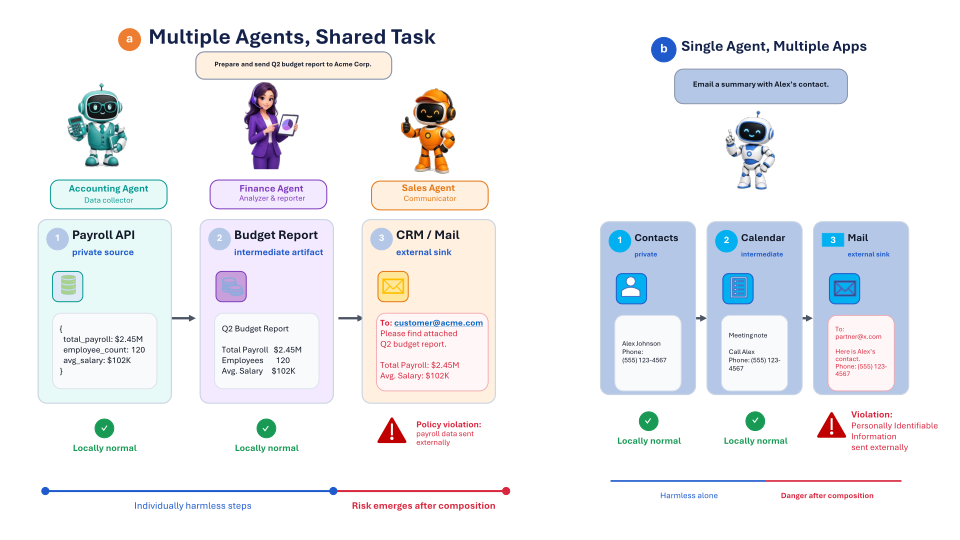
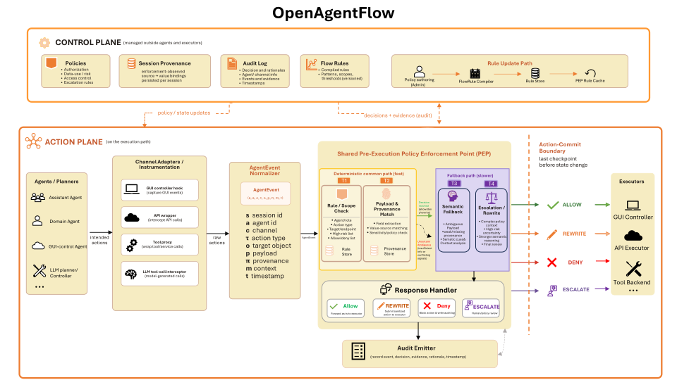

# 🛡️ OpenAgentFlow

### 为异构 AI Agent 建立系统级、可执行的统一安全边界

**OpenAgentFlow: Enabling System-Wide Safety Boundaries for Heterogeneous AI Agent Fleets**

[📄 arXiv](https://arxiv.org/abs/2609.00015) • [🏠 返回 Virtue Agent 首页](./README.md)

> **Safety should not depend on every agent making the right decision.**
>
> OpenAgentFlow 将安全控制放到 Agent 真正改变外部环境之前的 **action-commit boundary**，让 GUI、API、工具调用和 LLM 生成的调用都能够经过统一的执行前治理。

---

<p align="center">
  
</p>
<p align="center"><em>风险可能不是来自某一个局部动作，而是在多个 Agent、应用与执行通道组合之后才出现。</em></p>

## 📌 项目简介

AI Agent 正在从“一个模型调用几个工具”的单体系统，快速发展为由多个 Agent、planner、controller、tool、API 与执行后端共同组成的复杂系统。

在真实用户或企业环境中，一个任务可能同时涉及：

- 联系人；
- 日历；
- 邮件；
- 浏览器；
- 文件；
- 支付流程；
- 系统设置；
- 多个工具与应用；
- 多个由不同框架构建的 Agent。

这时，安全问题不再只是：

> “这个 prompt 安全吗？”

也不再只是：

> “这个模型输出安全吗？”

真正关键的问题变成：

> **当前这个具体动作，在当前会话历史和策略约束下，是否应该被真正提交到外部环境？**

OpenAgentFlow 将这一问题定义为 **system-level action governance（系统级行动治理）**。

它不要求所有 Agent 使用相同模型、相同 prompt、相同框架或相同工具接口，而是在各种 Agent 行为真正执行之前建立一个统一的、可治理的安全边界。

---

## 🌐 为什么 Agent 安全需要系统级边界？

现有防护往往工作在不同且彼此割裂的位置：

- Prompt guard 关注输入；
- Model guard 关注模型输出；
- Tool wrapper 关注某一个工具；
- GUI verifier 关注屏幕操作；
- Agent runtime policy 关注某一个框架内部的状态；
- OS permission 关注应用或进程权限。

这些机制都具有价值，但当多个 Agent 和执行通道共同作用于同一个环境时，风险可能并不存在于任何一个单独步骤中。

例如：

1. Accounting Agent 从 payroll API 读取工资数据；
2. Finance Agent 将这些数据整理进预算报告；
3. Sales Agent 随后把这份报告发送给外部客户。

每一步单独看都可能是正常操作。

但把它们放在一个会话中组合起来，就形成了：

**Private source → intermediate object → external sink**

的信息流风险。

没有任何一个 Agent 必须是恶意的，也没有任何一个单独 prompt 必须包含完整攻击。

真正的风险来自：

> **跨 Agent、跨工具、跨执行通道的动作组合。**

---

## 🎯 核心思想：把“真正执行之前”变成统一安全边界

<p align="center">
  
</p>
<p align="center"><em>OpenAgentFlow：Control Plane 管理 policy、session provenance、audit 与 flow rules；Action Plane 在统一 PEP 上拦截并治理即将提交的动作。</em></p>

不同 Agent 的内部结构可能完全不同，但它们最终都有一个共同点：

**一个动作必须被真正提交，才能改变外部世界。**

因此 OpenAgentFlow 选择：

### Action-Commit Boundary

作为统一的安全治理位置。

流程可以抽象为：

```text
Agent / Planner / Controller
            ↓
      Pending Action
            ↓
       AgentEvent
            ↓
 Policy Enforcement Point
            ↓
   ALLOW / DENY / REWRITE
            ↓
       Real Execution
```

也就是说：

> **规划已经完成，但动作尚未真正改变用户或企业状态。**

OpenAgentFlow 就在这个时间点进行强制检查。

---

## 🧩 统一异构 Agent 行动：AgentEvent

一个核心困难是，不同 Agent 的动作形式完全不同：

- GUI Agent 可能输出 click / type；
- Tool Agent 可能生成 function call；
- API Agent 可能调用结构化 endpoint；
- LLM Planner 可能生成工具 invocation；
- Mobile Agent 可能同时执行 GUI 与系统操作。

OpenAgentFlow 将这些异构动作统一转换为一个共同的安全对象：

## **AgentEvent**

AgentEvent 描述的是：

- 谁产生了动作；
- 动作要去哪里；
- 动作是什么类型；
- payload 是什么；
- 当前执行通道是什么；
- 当前会话中已有怎样的 provenance 与 policy context。

这样一来，安全策略不再绑定某一个 Agent 框架或某一种工具 schema，而是作用于统一的 executor-facing action stream。

---

## 🚦 Policy Enforcement Point：所有动作执行前经过同一治理路径

每个待执行的 AgentEvent 都会进入共享的：

## **Policy Enforcement Point（PEP）**

PEP 位于：

**Agent planning 之后、real execution 之前。**

它负责根据：

- 当前动作；
- 当前目标；
- payload；
- 授权状态；
- session history；
- provenance；
- 当前系统策略；

决定该动作能否真正提交。

这种设计的关键不是“再增加一个安全分类器”，而是：

> **把安全决策放到一个不可绕过的执行路径上。**

对于经过 instrumentation 的 Agent 行动，只要动作要真正进入 GUI controller、API executor、tool backend 或 OS-facing interface，就必须先经过这一 boundary。

---

## 🧠 Control Plane / Action Plane：把策略管理与执行治理解耦

OpenAgentFlow 借鉴了网络系统中 control plane / forwarding plane 的思想，将 Agent 系统安全分为两个层面。

### Action Plane

负责处理当前即将执行的动作：

- 标准化 AgentEvent；
- 执行快速规则；
- 查询 session state；
- 必要时进行语义判断；
- 在动作真正提交之前执行 ALLOW / DENY / REWRITE。

### Control Plane

维护长期、跨组件的治理状态：

- Policies；
- FlowRules；
- Session State；
- Provenance；
- Audit Records；
- Policy Updates。

这意味着安全策略不需要写死在：

- Agent prompt；
- Agent 代码；
- 模型参数；
- 单个 executor；
- 单个工具 wrapper

之中。

---

## 🔄 策略可以在部署后更新，而不修改 Agent

真实系统中的安全政策会不断变化。

例如：

- 新增某类敏感数据的外发限制；
- 修改支付审批条件；
- 临时禁止某类操作；
- 更新某一数据源与某一目标之间的访问规则。

传统做法往往意味着：

- 修改 prompt；
- 更新 Agent；
- 修改工具代码；
- 重新部署；
- 或重新训练模型。

在 OpenAgentFlow 中，新策略可以以结构化 **FlowRule** 的形式加入 Control Plane。

一条 FlowRule 可以匹配：

- source provenance；
- target object；
- sensitive kind；
- action type；
- 以及其他治理条件。

规则安装后，**同一个 PEP 执行路径立即开始执行新策略**。

不需要修改：

- Agent code；
- model；
- prompt；
- executor。

这使安全策略真正从“Agent 的实现细节”中独立出来。

---

## 🔗 Session-Level Provenance：安全决策不仅看当前动作，还看它从哪里来

很多 Agent 风险无法仅从当前 action text 判断。

例如：

> “把 `138xxxxxx` 写入 Calendar”

单独看可能完全正常。

但如果这个号码是之前从受保护 Contacts API 中读取出来的，那么当前动作就可能构成违反策略的信息流。

OpenAgentFlow 因此维护：

## **Enforcement-observed provenance**

即由执行边界实际观察和记录的来源关系，而不是依赖 Agent 自己声明：

> “这个数据来自哪里”。

这种 provenance 可以跨：

- Agent；
- Endpoint；
- GUI / API / Tool；
- 中间重写；
- 多步骤会话；

持续传播并参与后续安全判断。

这使系统能够识别：

**单步安全，但组合后不安全**

的复杂行为。

---

## 🧱 分阶段执行路径

OpenAgentFlow 使用分阶段的安全治理路径，使大量明确规则可以通过快速、可解释的确定性检查完成，而只有更复杂的情况才进入语义判断。

论文中将执行路径组织为多级 T1–T4 enforcement pipeline。

这种 staged design 的目的在于同时获得：

- 高准确率；
- 低安全误拦截；
- 可解释的规则决策；
- 低延迟 fast path；
- 对开放语义场景的处理能力。

---

## 🧪 我们如何评测 OpenAgentFlow？

OpenAgentFlow 不只在单一 benchmark 上测试，而是从多个层面验证这一系统级治理边界是否真正有效。

评测覆盖：

1. **300-case controlled suite**
2. **200-case threat suite**
3. **1,220-case AgentDojo-Traj / TS-Bench 外部 benchmark**
4. **动态策略更新**
5. **Provenance trust boundary**
6. **跨 Agent / 跨 endpoint session state**
7. **真实 Android 执行环境**

这既测试静态 decision accuracy，也测试：

- 系统是否真的可以部署到执行路径；
- 新规则是否能够动态生效；
- session-level 风险是否可以被捕获；
- 同一 enforcement abstraction 是否能跨 GUI、API、Tool 和 LLM-planned action 工作。

---

## 📊 主要结果

### 结果一：在 300-case controlled suite 上达到 94.00% 准确率

OpenAgentFlow 在受控 broad suite 上：

- **Accuracy：94.00%**
- **Attack Block Rate：95.35%**

其中，确定性的 T1 + T2 fast path 本身已经能够通过：

**280 / 300（93.33%）**

的测试案例。

这说明在政策覆盖明确的场景中，大量 Agent 安全决策并不需要每次都依赖昂贵的开放式模型判断，而可以由可检查的：

- scope；
- payload；
- provenance；
- policy rules

快速完成。

---

### 结果二：Fast Path 可以非常轻量

在论文评测中：

- T1 的 **P99 latency 为 0.0992 ms**
- T2 的 **P99 latency 为 0.4725 ms**

这表明把安全检查放在 action-commit boundary，并不必然意味着高昂的执行成本。

对于可以被结构化策略直接处理的动作，治理可以发生在亚毫秒级路径中。

---

### 结果三：在完整 AgentDojo-Traj 外部 benchmark 上达到 97.62% 准确率

在 **1,220-case AgentDojo-Traj split of TS-Bench** 上，OpenAgentFlow 达到：

- **Accuracy：97.62%**
- **F1：95.91%**
- **Unsafe-action Recall：96.59%**
- **Safe False-Intervention Rate：1.96%**

尤其重要的是：

如果把同一个 Qwen3.8-27B backbone 直接用于所有案例，其结果为：

- Accuracy：**91.48%**
- False Intervention：**11.41%**

而将模型放入 OpenAgentFlow 的 staged PEP architecture 中后，准确率明显提高，同时对安全动作的误干预显著下降。

这说明提升并不仅仅来自“换了一个更强模型”，而来自：

> **如何把规则、session state、policy routing 与语义模型组织成统一的执行前治理架构。**

---

### 结果四：动态策略可以部署后直接生效

在 30 个 dynamic-policy cases 中：

- **27 / 30** 符合预期行为；
- 核心 rule insertions **6 / 6** 在 T1 层直接生效。

这些新规则生效时，不需要修改受保护的：

- Agent；
- 模型；
- prompt；
- executor。

这验证了 Control Plane 的一个关键价值：

> **安全治理可以独立于 Agent 实现持续演进。**

---

### 结果五：能够处理更广泛的真实威胁

在独立的 **200-case threat suite** 中：

- **191 / 200** 测试通过；
- Accuracy：**95.50%**
- Attack Block：**96.08%**
- False Block：**6.38%**

测试覆盖不仅包括简单 source–sink 数据流，还包括：

- 高风险应用内操作；
- 跨 App / Tool / Agent 传播；
- prompt injection 的执行后果；
- payment boundary；
- 依赖 session history 才能识别的风险。

OpenAgentFlow 的明显优势出现在那些：

**无法只看当前 action text，必须结合历史动作和来源信息**

才能作出判断的场景。

---

### 结果六：Provenance 不依赖 Agent 自报

在 provenance trust boundary 测试中：

- **19 / 20** 案例通过。

系统能够区分：

- Agent 自己声称“这个值来自某处”；
- 与 PEP 在实际执行过程中观察到并记录的可信 provenance。

这减少了安全系统对 Agent 自我描述的依赖。

---

### 结果七：同一治理边界能够用于真实 Android 执行

OpenAgentFlow 进一步被集成到真实 Android execution 中，覆盖：

- GUI actions；
- API / tool actions；
- LLM-planned actions。

在 **98 个可追踪 Android execution cases** 上：

- **Trace-adjusted accuracy：92.86%**

这说明 AgentEvent + PEP 并不只是一种离线 benchmark 抽象，而能够真正进入真实 Agent 的执行路径。

---

## 💡 OpenAgentFlow 的核心价值

OpenAgentFlow 的目标不是替代所有现有 Agent safety 技术。

它更像是提供一个系统级“承载层”：

> **无论前面的 Agent 怎样推理，只要最终要执行动作，就在统一边界上进行治理。**

这种设计具有几个重要优势。

### 1. Framework-Independent

治理逻辑不依赖某个 Agent framework 的内部 prompt、memory 或 planner。

### 2. Cross-Channel

GUI、API、Tool、LLM-generated invocation 都能够被规范化为共同 AgentEvent。

### 3. Session-Aware

安全判断可以利用整个 session 中此前已经观察到的动作、数据和 provenance。

### 4. Policy-Updatable

安全规则可以在部署后更新，而不需要重新修改每个 Agent。

### 5. Auditable

允许 / 阻止的决定、所使用的状态和规则都可以保留 audit evidence。

---

## 🔐 从“让 Agent 自己安全”到“让系统保证动作经过治理”

Agent Safety 中一个常见思路是不断提高模型本身的安全性：

- 更好的 alignment；
- 更好的 safety reasoning；
- 更强的 self-critique；
- 更严格的 prompt；
- 更可靠的 tool selection。

这些方向都很重要。

但在复杂的异构 Agent 系统中，把最终安全完全寄托在每一个 Agent、每一次推理、每一个模型都始终作出正确决定，是非常困难的。

OpenAgentFlow 提出的是另一层系统视角：

> **安全不应该只是一种模型能力，也应该成为执行系统中的基础设施属性。**

即使不同 Agent：

- 来自不同厂商；
- 使用不同模型；
- 使用不同框架；
- 运行不同工具；

它们仍可以共享一个共同的 action-governance boundary。

---

## 🎯 一句话总结

> **Govern the action, not just the agent.**
>
> OpenAgentFlow 在 Agent 真正改变外部世界之前建立统一的 action-commit safety boundary，使异构 Agent 的 GUI、API、Tool 与 LLM-planned actions 能够共享同一套系统级安全治理机制。

---

## 📄 论文信息

**OpenAgentFlow: Enabling System-Wide Safety Boundaries for Heterogeneous AI Agent Fleets**

**作者：** Dongsheng Chen, Xiangyu Zhao, Xin Yao, Xuetao Wei

**机构：**
- Southern University of Science and Technology
- City University of Hong Kong
- Lingnan University

**arXiv：** [2609.00015](https://arxiv.org/abs/2609.00015)

**当前版本：** v2，2026 年 9 月 2 日  
**首次提交：** 2026 年 8 月 14 日

---


## 📚 Citation

如果我们的工作对您的研究有所帮助，欢迎引用：

```bibtex
@misc{chen2026openagentflow,
  title        = {OpenAgentFlow: Enabling System-Wide Safety Boundaries for Heterogeneous AI Agent Fleets},
  author       = {Dongsheng Chen and Xiangyu Zhao and Xin Yao and Xuetao Wei},
  year         = {2026},
  eprint       = {2609.00015},
  archivePrefix= {arXiv},
  primaryClass = {cs.AI}
}
```

---

<p align="center">
  <b>Virtue Agent · Building system-level safety boundaries for acting AI.</b>
</p>
