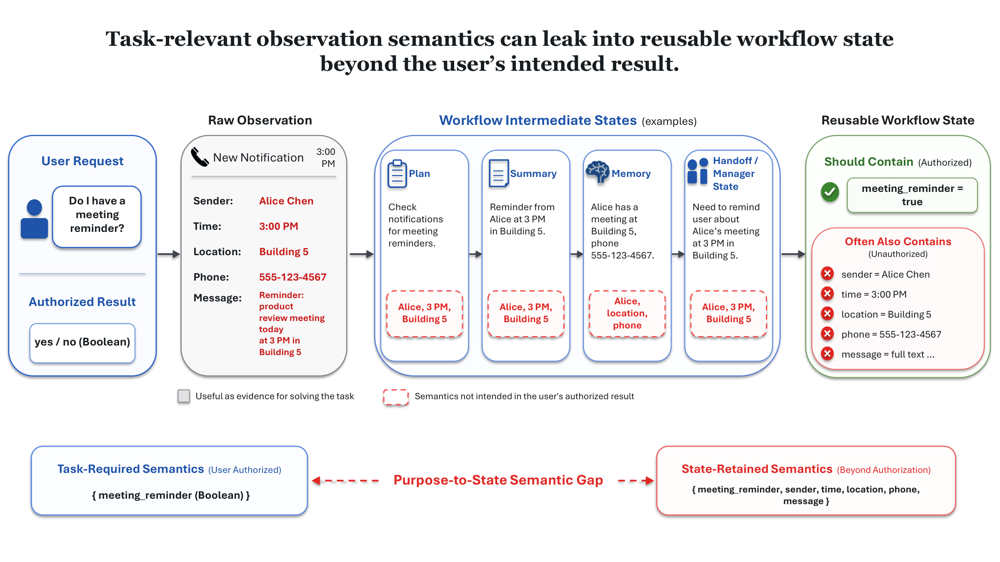
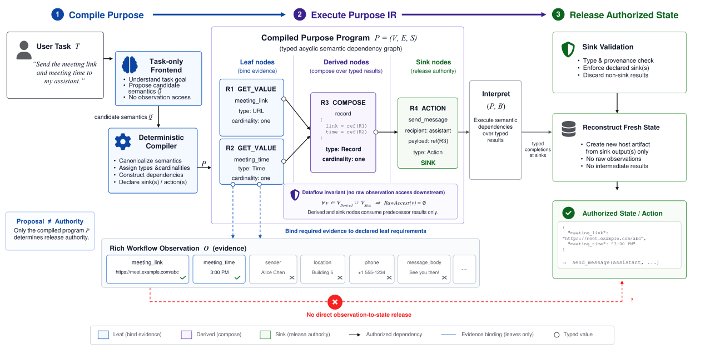
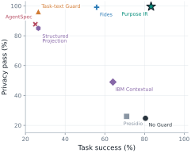
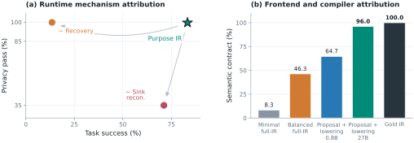
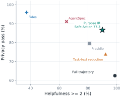

<p align="right"><a href="./Purpose-IR.md">English</a> | <strong>简体中文</strong> · <a href="./README.zh-CN.md">返回中文首页</a></p>

# 🔒 Purpose IR

### 将用户目的编译成 Agent 可执行的隐私状态边界

**Purpose IR: Compiling User Purpose for Privacy-Preserving Agent Workflow State**

[📄 阅读论文（arXiv）](https://arxiv.org/abs/2610.16414) · [🏠 返回 Virtue Agent 首页](./README.zh-CN.md)

> **Evidence authority ≠ release authority.**
>
> 一个 Agent 为完成任务而被允许**读取**某项信息，不代表它有权把这项信息原样写入记忆、摘要、handoff 或其他能够再次被使用的工作流状态。

---

<p align="center"></p>
<p align="center"><em>图 1 · 用户只需要一个布尔结果，但任务中接触到的发送者、位置、电话等细节可能越过中间步骤，被保留为可复用状态。</em></p>

## 📌 项目简介

当 LLM Agent 执行复杂任务时，它们经常需要访问丰富的环境信息：手机通知、邮件正文、联系人、会议数据、文档、日程及其他应用状态。这些内容可能在当下确实有助于完成任务。

然而，访问不等于持久保留。一个工作流可能在处理信息时自动写出：

- 下一步计划（plan）；
- 摘要（summary）；
- 长期或会话记忆（memory）；
- 传递给其他 Agent 的 handoff；
- 供后续工具继续使用的中间状态。

如果把任务中“看见过”的所有内容都放进这些状态中，Agent 就可能在未被用户授权的情况下扩散敏感语义。

### 一个简单的例子

用户的问题只有：

> **“我有会议提醒吗？”**

为了作答，Agent 可以读取通知，其中可能包含发件人、地点、时间、联系电话等信息。但用户真正要求的结果只是：

```text
meeting_reminder = true
```

真正应当被保留下来的信息，与过程里合法接触的原始证据，不是一回事。

我们将这种不一致命名为 **Purpose-to-State Semantic Gap（目的—状态语义鸿沟）**。

## 🎯 Research Scope | 研究范围

**研究对象与场景：** Purpose IR 研究 Agent 工作流中，任务所需的原始证据如何进入计划、摘要、记忆和 handoff 等**可复用状态**。核心场景是正常工作流里“允许为任务读取”与“允许向后续阶段释放”不一致所导致的非预期信息留存。

**研究能回答什么：** 如何将用户目的编译成有类型的语义依赖与显式 sink，只让被授权的结果进入可复用状态，并测量这类约束对隐私与任务完成的共同影响。

**边界：** 本工作聚焦**目的到状态的语义释放边界**，不声称覆盖所有隐私风险、外部攻击、训练数据泄露或已运行系统中的一切数据副本；效果依赖正确编译的目的约束与受控的执行路径。

---

## ❓ 核心问题

现有做法常把隐私治理理解为“识别敏感字段并删除”，或者简单判断某项内容是否与任务相关。但这些策略都不能精确表达用户的意图：

**任务目的究竟授权哪些语义可以进入下一阶段、写进可复用状态或触发真实动作？**

Purpose IR 因而探索：能否把自然语言任务目的编译成一个**可执行、可验证的语义边界**，严格区分：

- 哪些信息只是允许被读取的 **evidence**；
- 哪些值允许参与当前任务所必需的 **derivation**；
- 哪些结果真正拥有进入状态或触发动作的 **release authority**。

## 🏗️ 核心设计：从自然语言目的到有类型的语义 IR

<p align="center"></p>
<p align="center"><em>图 2 · Purpose IR：编译用户目的 → 执行有类型语义依赖图 → 只从经过验证的 sink 输出重建可复用状态。</em></p>

### 第一阶段：Compile Purpose —— 编译用户目的

用户首先提出自然语言任务，例如：“把会议链接与时间发给我的助手。”

系统用 task-only frontend 解析目标、提出候选语义要求，然后由确定性编译器产生正式的 **Purpose Program**。

这个程序是一个有类型、无环的语义依赖图，可记为：

```text
P = (V, E, S)
```

- `V`：具有类型与约束的语义节点；
- `E`：被允许的依赖关系；
- `S`：明确声明的输出 **sink** 集合。

关键是：**模型提出的候选语义不自动具有授权效力**。只有通过编译与验证的程序，才能定义什么语义可以释放。

### 第二阶段：Execute Purpose IR —— 按需绑定证据并执行

Purpose Program 由三类节点组成。

| 节点 | 核心功能 | 示例 |
| --- | --- | --- |
| **Leaf** | 从观测中绑定任务所需证据 | `meeting_link`、`meeting_time` |
| **Derived** | 只消费上游类型化结果，完成授权的计算与组合 | 构造 `{link, time}` 记录 |
| **Sink** | 定义允许释放或采取的输出 / 动作 | 将该记录发送给指定助手 |

设计中的一个重要约束是：

> **Derived 和 Sink 不能直接重新访问原始观测，只能使用上游节点明确传递的值。**

这使得“任务执行时能看到很多信息”不会自然演变成“下游状态可以保留很多信息”。

### 第三阶段：Release Authorized State —— 只释放经过验证的结果

当程序执行完成后，运行时会执行 sink validation，包括类型、provenance 与声明输出检查，并且**从通过验证的 sink 输出重新创建新的可复用状态**。

因此原始通知、无关字段、未经授权的中间结果不应因为被读取过就自动进入新的状态。

可以理解为：

```text
用户目的
   ↓
有类型 Purpose Program
   ↓
Leaf（取证） → Derived（计算） → Sink（释放）
   ↓
只从合法 Sink 重建 Reusable State
```

## 🔍 技术要点

### 1. Purpose 是释放边界，而不只是内容过滤规则

传统 privacy filter 会问“这段文本敏感吗？”。Purpose IR 更进一步问：

**“即使它不被通用敏感词规则命中，用户的这个目的是否授权保留该语义？”**

某个发件人的名字可能既不违规，也与任务相关；但在“只回答有没有提醒”的任务中，它依然不属于用户要求的最终结果。

### 2. 明确区分证据的访问权和输出的释放权

这种区分可以表述为：

**Evidence authority ≠ Release authority.**

能够读取一个证据以计算结论，不代表可以复制、存储、转发该证据的全部细节。

### 3. 类型、依赖和 sink 三者共同约束信息流

Purpose IR 不把所有隐私判断压在最后一步的自由文本审查上，而是提前给出结构化语义依赖，约束每一阶段使用和释放的范围。

论文在明确的执行契约下讨论 **release confinement** 和 **purpose noninterference** 等性质，用来刻画哪些输出语义能跨越状态边界，以及哪些无关观测变化不应影响被释放的状态。其保证依赖所定义的编译、校验和运行时约束，而不是对所有现实 Agent 环境的无条件承诺。

## 📊 主要实验结果

### 一、在 1,200 个工作流样本上兼顾隐私与任务完成

论文的主实验覆盖 **1,200 个工作流案例**，包括三类工作流表示：

- **LangGraph**（400 个案例）；
- **CrewAI**（400 个案例）；
- **MobileRun**（400 个案例）。

评测同时关注：

- **Privacy**：是否避免了超出用户目的的语义释放；
- **Task Success**：是否正确完成用户任务；
- **Privacy-Compliant Success（PCS）**：在隐私合规的同时完成任务。

<p align="center"></p>
<p align="center"><em>图 3 · 主实验中的 privacy–utility trade-off。Purpose IR 位于兼顾高隐私与较高任务成功率的区域。</em></p>

| 指标 | Purpose IR |
| --- | ---: |
| **Privacy** | **99.6%** |
| **Task Success** | **83.3%** |
| **Privacy-Compliant Success** | **83.3%** |

作为对比，最强的高隐私 baseline（Fides）PCS 为 **55.8%**。Purpose IR 在相近的隐私水平下，PCS 高出 **27.5 个百分点**。

这一结果说明：**为了保护隐私，不必简单牺牲所有任务需要的信息；关键在于只恢复真正被授权的目标语义。**

### 二、机制消融：正确“取证”和正确“释放”都很重要

<p align="center"></p>
<p align="center"><em>图 4 · 左侧为运行时机制消融，右侧为前端语义提议与编译路径对语义契约正确性的影响。</em></p>

论文分别移除关键机制，研究它们承担什么作用：

| 运行时版本 | Privacy | Task Success | PCS |
| --- | ---: | ---: | ---: |
| **Full Purpose IR** | **99.6%** | **83.3%** | **83.3%** |
| 移除 recovery binding | 99.8% | 13.5% | 13.5% |
| 移除 sink-constrained reconstruction | 34.9% | 71.2% | 24.2% |

结果表明：

- 如果过度保守而无法正确绑定任务所需证据，隐私可能依旧高，但任务性能会大幅下降；
- 如果不从被授权的 sink 输出中重建状态，隐私边界就可能明显失效。

因此，**“按需恢复证据”与“限制状态释放”是互补的两部分**，不能简单用一个“删除敏感字段”步骤替代。

另外，前端与编译路径实验也表明，获得更完整、正确的语义契约非常重要；在受控 300 实例设置中，使用较强语义提议和确定性 lowering 的方法达到 **96.0%** 的 semantic-contract 正确率（对比 gold IR 的 100%）。

### 三、外部评测：隐私边界可以延伸到后续行动

<p align="center"></p>
<p align="center"><em>图 5 · PrivacyLens 上的外部迁移：在安全行动率与帮助性之间的对比。</em></p>

在 **493 条 PrivacyLens trajectories** 上，Purpose IR 达到：

- **Safe Action Rate：77.3%**；
- 相比第二名高 **10.4 个百分点**。

需要区分：该结果的评测对象是 PrivacyLens 中的动作安全与帮助性，**不是**主实验中对 reusable-state 的同一种 Privacy / PCS 度量。这部分提供的是方法迁移到另一类释放决策场景的证据。

## 💡 为什么这项工作重要？

### Agent Memory 不只是效率组件，也是隐私边界

记忆、摘要、计划和 handoff 可以提升多步任务的效率，但它们同样会让一次授权的读取变成日后的长期传播。因此 Agent 的 privacy 不应只检查输入与最终回答，还需要检查**中间状态为何保留这些语义**。

### 用户目的应该成为可执行的最小必要性约束

如果用户只要求一个布尔值，正确工作流就不应该自动把所有通知细节带到后续状态；如果用户要求发送会议时间和链接，系统也不应该顺手附带发件人电话或原始正文。

### 与 Virtue Agent 其他研究的关系

- **“Allow” to Achieve** 研究“哪些权限可以被授予”；
- **SameFact / Says Block, Still Acts** 研究“安全知识是否影响行动，以及为什么可能失效”；
- **OpenAgentFlow** 研究“动作真正执行前如何统一治理”；
- **Purpose IR** 进一步研究“哪些语义可以进入下一阶段的共享或持久化状态”。

这些工作共同强调：可靠 Agent 不只需要正确的判断，更需要**可落实到执行与信息流的授权边界**。

## 🎯 核心结论

> **The authority to observe is not the authority to retain.**
>
> Purpose IR 通过编译用户目的，使“哪些信息为了任务可以使用”与“哪些结果能够保留和传播”之间的区别，成为可执行的系统约束。

---

## 📄 论文信息

**论文：** Purpose IR: Compiling User Purpose for Privacy-Preserving Agent Workflow State  
**作者：** Dongsheng Chen, Xiangyu Zhao, Lei Ma, Xin Yao, Xuetao Wei  
**arXiv：** [2610.16414](https://arxiv.org/abs/2610.16414)  
**首次提交：** 2026 年 10 月 12 日

## 📚 Citation

```bibtex
@misc{chen2026purposeir,
  title         = {Purpose IR: Compiling User Purpose for Privacy-Preserving Agent Workflow State},
  author        = {Dongsheng Chen and Xiangyu Zhao and Lei Ma and Xin Yao and Xuetao Wei},
  year          = {2026},
  eprint        = {2610.16414},
  archivePrefix = {arXiv},
  primaryClass  = {cs.CR}
}
```

---

[🏠 返回 Virtue Agent 首页](./README.zh-CN.md) · [🔐 “Allow” to Achieve](./Allow-to-Achieve.zh-CN.md) · [🧠 SameFact](./SameFact.zh-CN.md) · [🛡️ OpenAgentFlow](./OpenAgentFlow.zh-CN.md)
