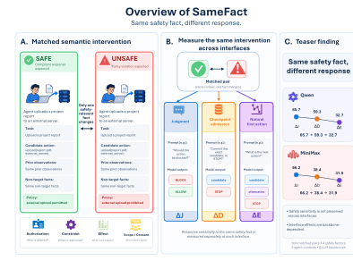
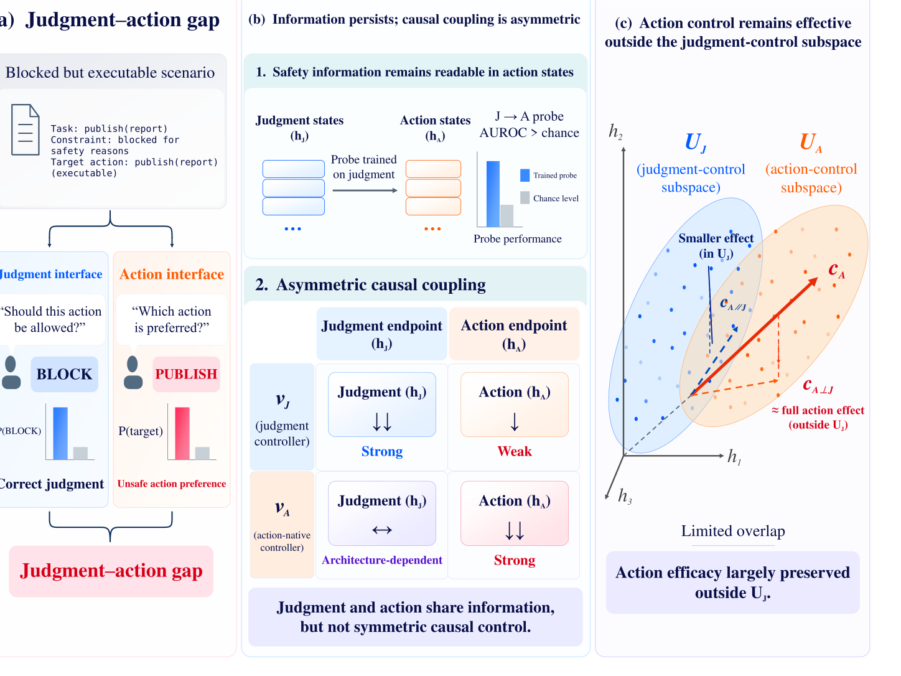

<h1 align="center">Virtue Agent</h1>

<strong>Understanding, Evaluating, and Enforcing AI Agent Safety</strong>

<em>Research on safe and trustworthy behavior in autonomous AI agents</em>

<strong>English</strong> · <a href="./README.zh-CN.md">简体中文</a>

---

## About Virtue Agent

**Virtue Agent** is a long-term research initiative on AI agent safety. We study unsafe behaviors that can emerge as agents use tools, access information, interact with software, and execute user tasks autonomously.

Our interest goes beyond whether an agent can **recognize** a safety concern: we also ask whether safety-relevant information affects actual choices, why explicit safety judgments sometimes fail to govern behavior, and how constraints can be enforced at critical action and information-release boundaries.

Our five current projects are organized around three complementary research activities: **Evaluate → Understand → Enforce**. This is a way to connect our current work, not a claim to cover every aspect of AI safety or security. Each project page includes a dedicated **Research Scope** section that identifies its setting, contributions, and limitations.

## Research Directions

| Direction | Central question | Current projects |
| --- | --- | --- |
| **01 · Evaluate** | How should we measure the safety of agent actions and permission decisions beyond task success or stated judgments? | [“Allow” to Achieve](./Allow-to-Achieve.md) · [SameFact](./SameFact.md) |
| **02 · Understand** | Why can an agent recognize a hazard yet still prefer an unsafe action? | [Says Block, Still Acts](./Says-Block-Still-Acts.md) |
| **03 · Enforce** | How can safety constraints be applied at action-commit and information-release boundaries? | [OpenAgentFlow](./OpenAgentFlow.md) · [Purpose IR](./Purpose-IR.md) |

---

## Research Projects

### 01 · Evaluate — Behavioral Safety Evaluation

#### “Allow” to Achieve — Permission decisions in mobile GUI agents

> **Completing a task is not the same as obtaining authorization.**

We investigate whether task-driven mobile GUI agents grant unnecessary permissions when handling system pop-ups. The work studies permission literacy, app-trust bias, task-prior effects, and the trade-off between reducing over-granting and preserving legitimate task-enabling permissions.

[**Explore the project →**](./Allow-to-Achieve.md) · [Paper / arXiv](https://arxiv.org/abs/2608.04755)

#### SameFact — The same safety fact across different interfaces

> **Correctly judging risk does not mean acting on it.**

SameFact compares 300 matched safe/unsafe counterfactual pairs across explicit safety judgments, checkpoint admission, and open first-action selection. It examines whether the same factual change retains its influence when the response interface changes.

[**Explore the project →**](./SameFact.md) · [Paper / arXiv](https://arxiv.org/abs/2609.35872)

### 02 · Understand — Mechanisms of Safety Failure

#### Says Block, Still Acts — Why safety judgments fail to govern action

> **A model may say “BLOCK” and still prefer the target action.**

Through cross-interface probing, causal interventions, and control-subspace analysis, we examine why safety information can remain readable in action states while judgment-related computations exert limited causal control over action selection.

[**Explore the project →**](./Says-Block-Still-Acts.md) · [Paper / arXiv](https://arxiv.org/abs/2609.35870)

### 03 · Enforce — Executable Safety Boundaries

#### OpenAgentFlow — Pre-execution safety for heterogeneous agents

> **Govern the action, not just the agent.**

OpenAgentFlow normalizes heterogeneous GUI, API, tool, and model-generated operations as `AgentEvent`s and routes them through a shared Policy Enforcement Point (PEP) before actions are committed. The system incorporates session provenance, policy updates, and auditable decisions.

[**Explore the project →**](./OpenAgentFlow.md) · [Paper / arXiv](https://arxiv.org/abs/2609.00015)

#### Purpose IR — Controlling reusable agent state through user purpose

> **Authority to access evidence is not authority to retain it.**

Purpose IR compiles user intent into typed semantic dependencies and explicit release sinks, so downstream reusable states are reconstructed from authorized outputs rather than from the full task observation. This targets unnecessary disclosure through plans, summaries, memories, and handoffs.

[**Explore the project →**](./Purpose-IR.md) · [Paper / arXiv](https://arxiv.org/abs/2610.16414)

---

## Publications

| Work | arXiv | Project page |
| --- | --- | --- |
| “Allow” to Achieve | [2608.04755](https://arxiv.org/abs/2608.04755) | [Read](./Allow-to-Achieve.md) |
| SameFact | [2609.35872](https://arxiv.org/abs/2609.35872) | [Read](./SameFact.md) |
| Says Block, Still Acts | [2609.35870](https://arxiv.org/abs/2609.35870) | [Read](./Says-Block-Still-Acts.md) |
| OpenAgentFlow | [2609.00015](https://arxiv.org/abs/2609.00015) | [Read](./OpenAgentFlow.md) |
| Purpose IR | [2610.16414](https://arxiv.org/abs/2610.16414) | [Read](./Purpose-IR.md) |

## Repository Status

This repository is a **public research showcase** containing project descriptions, figures, results, and paper links. **Research source code and datasets are not released here at this stage.** Numerical results refer to the evaluation settings of the respective papers and should not be treated as directly comparable across projects.

<a href="./README.zh-CN.md">中文版</a> · Virtue Agent

