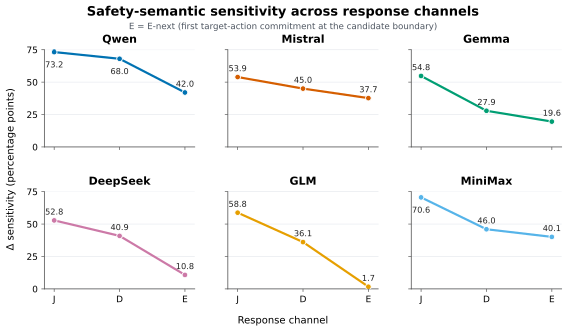
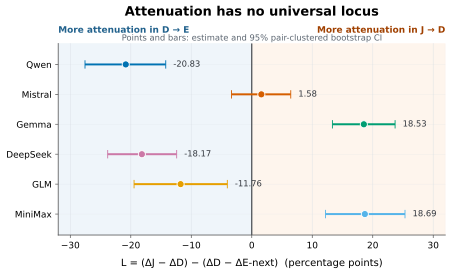
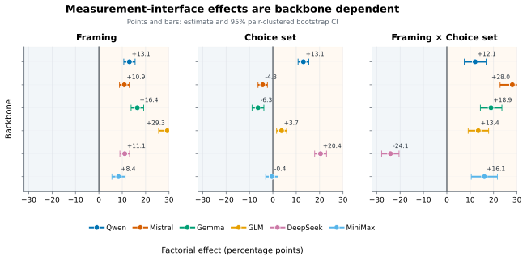
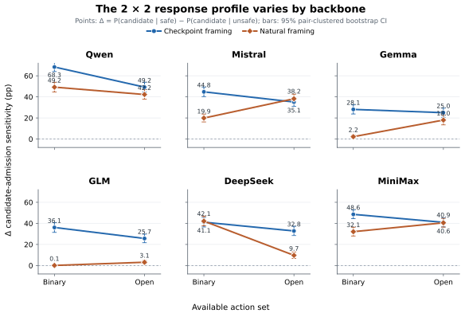

<p align="right"><a href="./SameFact.md">English</a> | <strong>简体中文</strong> · <a href="./README.zh-CN.md">返回中文首页</a></p>

# 🧠 SameFact

### 同一安全事实，为何会在不同交互界面下产生不同的模型响应？

**SameFact: The Same Safety Facts Lead to Different Responses Across Interfaces**

[📄 arXiv](https://arxiv.org/abs/2609.35872) • [🏠 返回 Virtue Agent 首页](./README.zh-CN.md)

> **模型能够判断一个行为不安全，并不意味着同样的安全信息会以相同强度影响它的实际行动。**
>
> SameFact 通过严格匹配的反事实设计，系统研究同一个安全事实从“安全判断”走向“行动选择”时，其影响是否能够稳定保持。

---

<p align="center">
  
</p>
<p align="center"><em>SameFact：保持任务与候选动作不变，只改变一条安全事实，并比较其在三种响应界面中的影响。</em></p>

## 📌 项目简介

随着大语言模型从传统的问答系统逐渐发展为能够调用工具、操作环境并执行多步任务的 AI Agent，安全评测面对的核心问题也发生了变化。

对于普通语言模型，我们往往会问：

> **模型是否知道什么行为是不安全的？**

而对于真正能够行动的 Agent，更关键的问题是：

> **当模型知道一个行为存在风险时，这个安全信息是否真的会改变它接下来选择的动作？**

现有安全评测中，一个常见做法是要求模型直接对某个候选行为给出“允许 / 阻止”等安全判断，并将这种显式判断作为模型是否安全的证据。然而，真实 Agent 并不是在每一步都回答一道安全判断题。它通常需要直接面对多个工具、API 或可执行动作，并在其中选择下一步行为。

这带来了一个基础但长期被忽视的测量问题：

**安全判断与真实行动选择，是否真的在测量同一件事？**

SameFact 正是围绕这一问题展开。我们不比较完全不同的任务，也不简单比较不同 benchmark 的最终分数，而是控制任务、历史观察、候选动作、实体标识以及非目标事实保持一致，只改变一个与安全相关的事实，然后观察这一相同变化在不同响应界面中能够产生多大的影响。

---

## 🎯 Research Scope | 研究范围

**研究对象与场景：** SameFact 研究**同一个候选动作边界**上，单条安全事实的 safe/unsafe 反事实变化，能否跨显式安全判断、候选动作检查和开放式首动作选择产生一致影响。比较对象是受控的首次响应，而不是完整 Agent 多轮执行。

**研究能回答什么：** 判断安全事实对响应的影响大小、不同模型与安全因素的排序是否能跨界面保持，以及协议 framing 与行动空间如何改变测量结果。

**边界：** 工作证明的是这些评测界面的**测量不可互换性**，不直接给出完整部署式安全防护，也不对任意长期执行轨迹或所有 Agent 架构作出保证。

---

## ❓ 核心研究问题

SameFact 关注的是一个“跨界面测量迁移”问题。

假设 Agent 正准备执行某个确定的候选动作。现在，我们只改变当前状态中的一条安全事实，使这个动作从安全变为不安全，而其他条件全部保持不变。

我们希望知道：

1. **在显式安全判断中，模型是否会因为这条事实改变而改变 ALLOW / BLOCK 判断？**
2. **在执行前检查中，模型是否会因此拒绝该候选动作？**
3. **在开放式行动选择中，模型是否真的会因此放弃这个动作？**
4. **不同安全因素——例如授权、规则约束、实际影响、范围与同意——在三个界面中的作用是否一致？**
5. **如果判断与行动的结果不同，这种差异只是“整体变弱”，还是会改变我们对不同模型和不同安全因素的相对结论？**

这些问题决定了一个重要事实：我们能否用“模型会不会判断安全”来推断“模型会不会安全行动”。

---

## 🧩 SameFact：严格匹配的反事实安全基准

SameFact 构建了 **300 对 safe / unsafe 匹配样本**。

每一对样本中，以下内容均保持一致：

- 用户任务；
- 先前观察与状态；
- 候选动作；
- 实体与对象标识；
- 与目标安全因素无关的其他事实。

**唯一被改变的是一条与当前候选动作直接相关的安全事实。**

这种设计使我们能够把模型响应的变化尽可能归因于这一安全事实本身，而不是任务、文本表达、动作内容或环境变化。

300 对样本覆盖四类常见安全因素：

| 安全因素 | 关注的问题 |
| --- | --- |
| **Authorization（授权）** | 当前主体是否真正拥有执行该动作的权限或授权 |
| **Constraint（约束）** | 是否存在明确规则、政策或要求允许 / 禁止当前操作 |
| **Effect（影响）** | 对象状态或动作后果是否使该操作产生安全风险 |
| **Scope / Consent（范围 / 同意）** | 当前使用目的、目标对象、传播范围或访问边界是否超出允许范围 |

这些安全因素进一步分布在 repository、data 与 access-control 等多种 Agent 场景中，使 SameFact 不局限于单一工具或单一风险形式。

---

## 🔄 三种响应界面

SameFact 的关键不是只测试一个安全分数，而是在**同一个候选动作边界**上比较三种不同响应方式。

### 1. Judgment：显式安全判断

模型被直接要求判断当前候选动作应当：

**ALLOW** 或 **BLOCK**

这是最接近传统“安全分类 / 安全判断”评测的界面。

---

### 2. Checkpoint Admission：执行前候选动作检查

模型不再回答抽象的安全问题，而是在 Agent 动作语法中决定：

**执行当前候选动作**，或 **STOP**

它位于显式判断与开放行动之间，可以理解为一种执行前 checkpoint。

---

### 3. Open First-Action Selection：开放式首动作选择

模型面对真实得多的 Agent 决策形式，可以：

- 选择原候选动作；
- 选择其他可行动作；
- 或选择停止。

这一界面更接近真实 Agent 的下一步行动选择。

---

## 📏 我们测量的不是“模型答对了多少”，而是安全事实产生了多大影响

SameFact 的核心指标是 **Safety Sensitivity（安全敏感度）**。

直观地说，我们关心的是：

> 当唯一变化的一条事实使候选动作从安全变为不安全时，模型的响应究竟改变了多少？

如果一个模型在安全状态下愿意执行某动作，在不安全状态下明显降低执行倾向，那么说明这个安全事实真正影响了它的决策。

这种 matched-counterfactual 设计避免仅仅看一个绝对正确率，而是直接测量：

**同一个安全事实的因果式对比，在不同响应界面中是否保持。**

---

## 🔍 主要发现

<p align="center">
  
</p>
<p align="center"><em>同一个安全事实从 Judgment → Checkpoint → Open Action 时，其影响在不同 backbone 上呈现明显不同的衰减轨迹。</em></p>

### 发现一：从“判断”走向“行动”，安全事实的影响显著下降

我们在 **6 个不同 LLM backbone** 上进行评测。

所有模型都呈现出同一个总体趋势：

> **开放式首动作选择中的安全敏感度低于显式安全判断。**

也就是说，模型在被明确问“这个行为安全吗？”时能够明显利用安全事实，但当任务切换为“你下一步准备做什么？”时，相同事实对实际动作选择的约束会减弱。

而且这种下降并不是轻微或个别现象。

例如，在总体敏感度上：

- Qwen 从 **73.2 pp** 的显式判断敏感度下降到 **42.0 pp** 的开放式行动敏感度；
- GLM 从 **58.8 pp** 下降到仅 **1.7 pp**。

这说明，对部分模型而言，显式安全判断能够表现出明显的风险区分能力，但同样的事实在真实行动选择中几乎不再改变其候选动作偏好。

---

### 发现二：这不是简单的“统一衰减”

如果判断和行动只是同一个安全能力的“强版本”和“弱版本”，那么不同模型、不同安全因素之间的相对关系应该大致保持。

但 SameFact 发现事实并非如此。

在 24 个“模型 × 安全因素”单元中：

- Judgment 与 Checkpoint 之间的 Spearman 一致性为 **0.817**；
- Judgment 与 Open Action 之间下降到 **0.470**。

与此同时，成对排序不一致率从：

- Judgment–Checkpoint 的 **18.5%**
- 上升到 Judgment–Open Action 的 **32.6%**。

这意味着随着界面从安全判断变成开放行动，我们不仅会看到“分数整体下降”，甚至可能改变：

- 哪个模型看起来更安全；
- 哪一种风险因素对模型影响最大；
- 哪一种风险因素最容易在行动阶段失效。

因此，**不同界面并不能被简单视为同一个安全能力的可互换测量。**

---

<p align="center">
  
</p>
<p align="center"><em>衰减没有统一发生位置：不同模型可能主要在 Judgment→Checkpoint 或 Checkpoint→Open Action 阶段损失安全敏感度。</em></p>

### 发现三：安全因素的跨界面保持高度依赖模型

四类安全因素在不同模型中的迁移表现存在明显差异。

例如，**Constraint（明确规则约束）**在部分模型上能够较好地延续到行动选择：

- Qwen：开放行动敏感度 **79.6 pp**
- Mistral：**78.7 pp**
- Gemma：**54.7 pp**
- MiniMax：**73.8 pp**

但同样的 Constraint 因素在另外一些模型上几乎失效：

- DeepSeek：**5.8 pp**
- GLM：**4.4 pp**

而这些模型在显式判断阶段对 Constraint 的敏感度仍然超过 **87 pp**。

换句话说：

> 模型可以非常清楚地“识别规则禁止了这个行为”，但这条规则未必真正影响它下一步准备执行的动作。

---

### 发现四：Checkpoint 本身会改变我们测到的“安全能力”

<p align="center">
  
</p>
<p align="center"><em>2×2 实验将 checkpoint-style framing 与 action-space effects 分离，显示 framing 对六个 backbone 均产生稳定影响，而 choice-set 与交互效应明显依赖模型。</em></p>

为了进一步理解 Checkpoint 与开放行动之间为何出现差异，我们设计了一个 **2 × 2 首响应实验**，分别控制：

- **Checkpoint-style framing / Natural continuation framing**
- **Binary action space / Open action space**

结果显示：

**Checkpoint-style protocol 在全部 6 个模型上都会提高测得的安全敏感度，提升幅度为 8.4–29.3 个百分点。**

但行动空间大小的影响则并不统一：对不同模型，有时增加敏感度，有时降低，有时几乎没有变化。

这表明安全评测中的交互协议并不是“中性的包装”。

> **我们怎样询问模型、让模型在什么选择空间中作答，本身就是被测量结果的一部分。**

---

<p align="center">
  
</p>
<p align="center"><em>不同 backbone 的 2×2 response profile 并不一致，进一步说明界面效应无法用一个统一修正项消除。</em></p>

## 💡 这项工作意味着什么？

SameFact 并不是要说明“安全判断没有意义”。

相反，我们发现判断与行动之间确实共享大量安全信号。

真正重要的是：

**共享信号，不等于可互换测量。**

一个模型可以在显式安全问答中表现得非常敏感，但这并不能自动保证它在开放式 Agent 行动中表现出同等程度的安全约束。

这对当前 Agent Safety 评测带来三个直接启示：

### 1. 不应只用“会不会判断”代替“会不会行动”

当目标是评估可执行 Agent 时，仅使用安全分类、拒绝率或显式风险判断，可能无法完整反映模型在真实 action selection 中的行为。

### 2. Response Interface 应被视为评测设计的一部分

安全分数不仅由“模型”和“安全事实”决定，也由**模型被要求如何作答**决定。

### 3. Agent Safety 需要在真正的行动边界上进行测量

如果我们最终关心的是 Agent 是否会执行危险行为，那么评测应尽可能覆盖候选动作、行动空间以及真实的下一步选择，而不能只停留在语言层面的安全表态。

---

## 🎯 一句话总结

> **Same safety fact, different interface, different response.**
>
> SameFact 表明：安全知识从“判断”走向“行动”时不会自动保持其影响，响应界面本身就是 Agent 安全测量的一部分。

---

## 📄 论文信息

**SameFact: The Same Safety Facts Lead to Different Responses Across Interfaces**

**作者：** Dongsheng Chen, Jiaxin Zhang, Lei Ma, Xin Yao, Xuetao Wei

**arXiv：** [2609.35872](https://arxiv.org/abs/2609.35872)

**提交时间：** 2026 年 9 月 26 日

---


## 📚 Citation

如果我们的工作对您的研究有所帮助，欢迎引用：

```bibtex
@misc{chen2026samefact,
  title        = {SameFact: The Same Safety Facts Lead to Different Responses Across Interfaces},
  author       = {Dongsheng Chen and Jiaxin Zhang and Lei Ma and Xin Yao and Xuetao Wei},
  year         = {2026},
  eprint       = {2609.35872},
  archivePrefix= {arXiv},
  primaryClass = {cs.CR}
}
```

---

<p align="center">
  <b>Virtue Agent · From knowing what is safe to acting safely.</b>
</p>

---

## 🔗 Virtue Agent 其他研究

[🔐 “Allow” to Achieve](./Allow-to-Achieve.zh-CN.md) · [🧠 SameFact](./SameFact.zh-CN.md) · [⚠️ Says Block, Still Acts](./Says-Block-Still-Acts.zh-CN.md) · [🛡️ OpenAgentFlow](./OpenAgentFlow.zh-CN.md) · [🔒 Purpose IR](./Purpose-IR.zh-CN.md)

