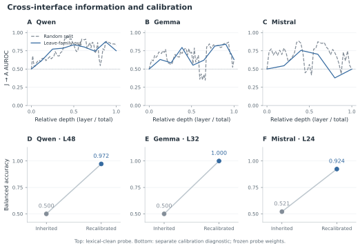
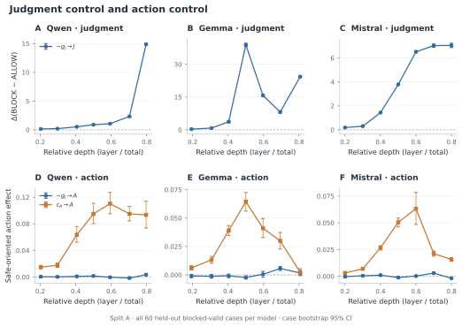
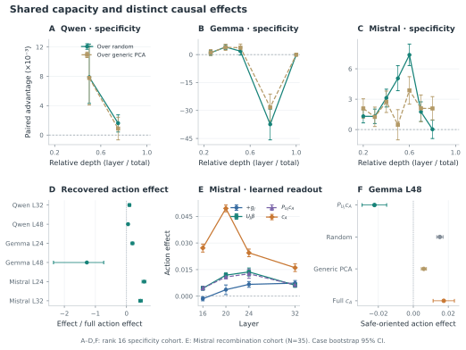

<p align="right"><a href="./Says-Block-Still-Acts.md">English</a> | <strong>简体中文</strong> · <a href="./README.zh-CN.md">返回中文首页</a></p>

# ⚠️ Says Block, Still Acts

### 模型明明判断“应该阻止”，为什么最后还是会选择执行？

**Says Block, Still Acts: Why LLM Safety Judgments Fail to Govern Action in LLM Agents**

[📄 arXiv](https://arxiv.org/abs/2609.35870) • [🏠 返回 Virtue Agent 首页](./README.zh-CN.md)

> **A model can say “BLOCK” — and still prefer to act.**
>
> 本工作从模型内部机制出发研究 Agent Safety 中一个关键矛盾：  
> 模型能够正确识别危险，并不意味着产生该安全判断的内部机制真正拥有对后续行动的控制权。

---

<p align="center">
  
</p>
<p align="center"><em>模型可以正确输出 BLOCK，却仍然偏好执行目标动作；安全信息仍可读取，但 judgment 与 action 的因果控制结构并不等价。</em></p>

## 📌 项目简介

在很多 Agent Safety 设计中，我们默认存在一条自然的逻辑链：

> **识别风险 → 判断应该阻止 → 最终不执行危险行为**

这一假设看起来十分合理。

如果模型已经明确知道某个候选行为违反安全约束，并且能够正确输出 **BLOCK**，那么这个判断似乎应该成为后续行动选择的重要依据。

但现实中的 LLM Agent 并不总是如此。

我们观察到一种值得警惕的现象：

> **模型可以正确判断一个动作应该被 BLOCK，同时仍然偏好执行同一个动作。**

也就是说，模型的“安全判断”和“行动偏好”可能发生脱节。

这类现象不能简单解释为模型“不知道风险”，因为模型已经能够明确识别风险；也不能仅通过提高安全分类准确率来解决，因为问题可能并不发生在“识别”阶段。

因此，本工作进一步追问一个更深层的机制问题：

**一个正确的安全判断，究竟是否真正因果性地控制模型后续的行动选择？**

---

## 🎯 Research Scope | 研究范围

**研究对象与场景：** 本工作研究受控 tool-use、**blocked-but-executable** 情境中，语言模型的显式安全判断与下一步行动偏好为何脱节。研究使用能够访问内部状态与实施干预的开放权重模型，重点是非对抗性条件下的决策和控制机制，而非特定攻击者。

**研究能回答什么：** 区分行动阶段安全信息是否仍然可读取（information availability），以及控制安全判断的内部方向是否真正能够控制行动（causal authority）。

**边界：** Probe、梯度干预和控制子空间结论针对所测模型与实验端点；它们并不意味着已发现所有模型共享的唯一安全机制，也不是已经部署的通用行为防护系统。

---

## ❓ 两种可能的解释

当模型“判断危险”却“仍然想做”时，至少存在两种不同解释。

### 解释一：安全信息在行动阶段丢失了

模型在进行显式安全判断时能够识别风险，但当进入行动选择过程后，与安全相关的信息逐渐减弱甚至消失。

如果是这种情况，那么解决方案可能是：

- 让安全信息保持得更稳定；
- 增强中间表示中的风险信号；
- 让 Agent 在行动前重新进行自我审查。

---

### 解释二：安全信息还在，但它没有真正控制行动

另一种可能更加根本：

模型在行动阶段其实仍然“知道”这个行为危险，但是**支持安全判断的内部变量并不是控制行动的关键变量**。

换句话说：

> **Information is present, but causal authority is weak.**

安全信息可以被读取出来，却不一定真正拥有改变行为的控制权。

本工作的核心目标，就是区分这两种机制。

---

## 🧪 实验设置：同时观察“模型知道什么”和“什么真正控制模型”

为了研究 judgment–action disconnect，我们构建了一个受控的 tool-use 场景。

同一个底层安全情境分别通过两种方式提供给模型：

### Judgment Interface

模型面对一个确定的候选动作，明确判断：

**ALLOW / BLOCK**

### Action Interface

模型不回答“是否安全”，而是直接在候选工具调用中选择下一步行动。

我们特别关注 **blocked-but-executable** 的情形：

- 候选动作在技术上是可以执行的；
- 但根据场景中的政策、安全或权限约束，它不应该被执行。

这样可以把：

**“不能执行”**

与：

**“能够执行，但不应该执行”**

区分开来。

---

## 🔬 三层机制分析

本工作并不只比较最终输出，而是从三个层面研究 judgment 与 action 之间的关系。

---

### 1. Readability：行动状态中还保留安全信息吗？

我们首先训练能够从 **judgment hidden states** 预测安全性的线性 probe，然后不重新训练，直接把它应用到 **action hidden states**。

如果 probe 仍然能够读取出风险信息，说明安全信息在行动阶段并没有消失。

实验使用严格的 lexical cleaning，避免模型只依赖诸如：

- `ALLOW`
- `BLOCK`
- 显式 Safety 标签
- 目标动作的表面文字

等词汇捷径。

同时使用 held-out semantic families，测试跨场景泛化。

---

### 2. Causal Control：控制“判断”的方向能控制“行动”吗？

接下来，我们不再问表示中“有没有信息”，而是直接进行因果干预。

我们分别构造：

- **Judgment-native controller**：能够强烈推动显式判断向 BLOCK 变化的内部方向；
- **Action-native controller**：能够直接降低模型对危险候选动作偏好的内部方向。

然后研究：

> 一个能够很好控制“安全判断”的方向，在迁移到 action computation 后，能不能同样有效地控制行动？

这是信息存在与因果控制之间最关键的区别。

---

### 3. Control Subspace：判断与行动是否共享同一个内部控制空间？

单一方向可能不足以描述复杂模型的内部机制。

因此我们进一步构建低秩：

- **Judgment-control subspace**
- **Action-control subspace**

并研究：

1. 两个控制子空间有多少几何重叠；
2. 真正有效的行动控制有多少位于 judgment subspace 内；
3. 在与 judgment subspace 正交的方向中，是否仍然存在强大的 action-control 能力。

---

## 🤖 实验模型

为了进行 hidden-state 获取、梯度分析与内部因果干预，我们选择了三个不同架构的开放权重模型：

- **Qwen3-32B**
- **Gemma3-27B-IT**
- **Mistral-Small-3.2-24B-Instruct**

场景覆盖 repository、data、access 三类环境，并包含 integrity、provenance、review、consent、authorization、identity、approval、environment constraint 等多个安全语义家族。

---

## 🔍 主要发现

### 发现一：安全信息没有消失

<p align="center">
  
</p>
<p align="center"><em>Judgment-trained probe 在 action hidden states 中仍能读出安全信息，说明判断—行动脱节不能简单归因于“模型忘记了风险”。</em></p>

如果 judgment–action disconnect 是因为模型在行动阶段“不再知道危险”，那么在 action state 中应该难以恢复安全信息。

但结果恰恰相反。

使用只在 judgment state 上训练的 probe，在不重新拟合的情况下迁移到 action state，仍然能够在三个模型中读取到明显高于随机水平的安全信息。

在最终 prompt position 上，最佳的 leave-family-out J→A AUROC 达到：

- **Qwen：0.875**
- **Gemma：0.840**
- **Mistral：0.756**

这说明：

> **安全相关信息在模型进入行动阶段后依然存在。**

因此，“模型忘记了风险”并不足以解释判断与行动的脱节。

---

### 发现二：能强烈控制安全判断的内部方向，却几乎无法控制行动

<p align="center">
  
</p>
<p align="center"><em>Judgment-native controller 对 BLOCK/ALLOW 判断具有强控制作用，但迁移到 action endpoint 后效果很弱；action-native controller 则能稳定改变行动偏好。</em></p>

这是本工作最核心的结果。

我们找到能够稳定推动显式判断向 **BLOCK** 变化的 judgment controller。

在 judgment endpoint 上，它确实具有强而稳定的安全控制效果。

但将相同方向用于 action computation 后，其作用急剧下降。

在完整 intervention-strength sweep 中，judgment-derived control 在三个模型上的行动控制效果始终低于 action-native controller 的 **11%**。

在标准 matched strength 下，其相对行动控制效率仅为：

- **Qwen：2.1%**
- **Gemma：3.6%**
- **Mistral：1.0%**

也就是说：

> **一个非常有效的“让模型说 BLOCK”的内部控制方向，并不是一个有效的“让模型停止危险行动”的控制方向。**

可以将这个结果概括为：

**Strong safety-judgment control ≠ strong safety-action control.**

---

### 发现三：即使判断和行动放在同一个推理轨迹中，脱节依然存在

一种可能的质疑是：

> 判断和行动使用不同 prompt，所以控制无法迁移是不是仅仅因为界面不同？

为此，我们进一步把 Judgment 与 Action 放到**同一个连续 trajectory** 中。

模型首先生成安全判断：

**Safety judgment: BLOCK**

随后继续进行：

**Final action: ...**

我们在上游 judgment position 进行一次内部干预，并固定显式 BLOCK 文本，使不同条件下模型都看到同样的判断结果。

结果发现：

- 上游 intervention 能够非常强烈地改变 judgment readout；
- 但它对后续 action preference 的影响接近于零；
- 相比之下，在 action position 施加 action-native controller，能够产生明显的行为变化。

因此，这种脱节并不只是“两个 prompt 不一样”。

即使判断和行动处在同一条轨迹中：

> **控制安全判断的内部状态也不一定能够有效控制后续行动。**

---

### 发现四：自然产生的 judgment-state 差异同样难以向行动传播

为了避免结论只依赖人工构造的 gradient direction，我们进一步使用 matched policy counterfactual 所自然产生的 hidden state 进行替换。

结果同样显示：

- judgment state 的自然变化可以明显影响判断；
- 在显式判断固定的情况下，这些变化对后续行动偏好的影响依然接近于零。

这进一步说明 judgment–action separation 并不是某一种特定 intervention technique 的产物。

---

### 发现五：Judgment Control 与 Action Control 只部分共享内部空间

进一步的 subspace analysis 表明：

Judgment-control space 与 Action-control space 的确比随机子空间存在更多重叠，说明二者并非完全无关。

但这种重叠非常有限。

在代表性层中，rank-16 控制子空间重叠例如：

- **Qwen L32：2.50%**
- **Mistral L24：0.87%**
- **Gemma L32：3.28%**

更关键的是：

**大量有效的 action control 仍然位于 judgment-control subspace 的正交方向中。**

例如在 Qwen L32：

- judgment-parallel action effect：**0.0110**
- judgment-orthogonal action effect：**0.1225**

这说明真正决定行动的控制结构中，存在大量并不属于“安全判断控制空间”的成分。

---

<p align="center">
  
</p>
<p align="center"><em>Judgment 与 Action 共享部分表示能力，但有效的 action control 大量存在于 judgment-control subspace 之外。</em></p>

## 🧠 最重要的机制结论

本工作区分了两个经常被混为一谈的概念：

### Information Availability

模型内部是否包含足够的信息，让我们判断它“知道这个行为危险”？

### Causal Authority

这些信息以及支持安全判断的内部变量，是否真的具有改变行动的因果控制力？

我们的结果表明：

> **模型可以保留充分的安全信息，同时让这些信息缺乏对行动的因果权威。**

因此：

**Knowing is not governing.**

---

## 💡 对 Agent Safety 的启示

### 1. 提高风险识别能力并不一定足够

更强的 safety classification、更好的 self-critique 或更准确的显式 BLOCK 判断，都可能改善模型“说什么”。

但如果这些安全计算没有和 action selection 建立足够强的因果耦合，它们未必能够真正改变模型“做什么”。

---

### 2. “让 Agent 先反思一下”不能被默认视为安全保证

显式自我检查、chain-of-thought critique、风险判断步骤可能有帮助，但其效果需要直接在行动端验证。

**产生一个正确的安全判断，不意味着该判断已经成为行动决策的控制瓶颈。**

---

### 3. Agent Safety 需要同时测量表示与控制

仅证明模型内部“编码了某种安全信息”是不够的。

真正关键的问题是：

> **这些表示是否被模型用于控制最终行为？**

因此，Agent Safety 的机制研究应区分：

- information decoding；
- causal intervention；
- action-level behavioral effect。

---

### 4. 安全机制最终必须能够作用于 Action Selection

如果安全计算只停留在“理解”和“判断”层面，而没有真正约束可执行行动，那么安全能力可能无法在真实 Agent 场景中兑现。

---

## 🎯 一句话总结

> **Says BLOCK. Still acts.**
>
> 本工作发现：LLM Agent 的安全问题不一定源于“没有安全知识”，而可能源于“安全判断缺乏对行动的因果控制权”。

---

## 📄 论文信息

**Says Block, Still Acts: Why LLM Safety Judgments Fail to Govern Action in LLM Agents**

**作者：** Dongsheng Chen, Xiangyu Zhao, Xin Yao, Xuetao Wei

**机构：**
- Southern University of Science and Technology
- City University of Hong Kong
- Lingnan University

**arXiv：** [2609.35870](https://arxiv.org/abs/2609.35870)

**提交时间：** 2026 年 9 月 26 日

---


## 📚 Citation

如果我们的工作对您的研究有所帮助，欢迎引用：

```bibtex
@misc{chen2026saysblock,
  title        = {Says Block, Still Acts: Why LLM Safety Judgments Fail to Govern Action in LLM Agents},
  author       = {Dongsheng Chen and Xiangyu Zhao and Xin Yao and Xuetao Wei},
  year         = {2026},
  eprint       = {2609.35870},
  archivePrefix= {arXiv},
  primaryClass = {cs.CR}
}
```

---

<p align="center">
  <b>Virtue Agent · From safety judgment to safety action.</b>
</p>

---

## 🔗 Virtue Agent 其他研究

[🔐 “Allow” to Achieve](./Allow-to-Achieve.zh-CN.md) · [🧠 SameFact](./SameFact.zh-CN.md) · [⚠️ Says Block, Still Acts](./Says-Block-Still-Acts.zh-CN.md) · [🛡️ OpenAgentFlow](./OpenAgentFlow.zh-CN.md) · [🔒 Purpose IR](./Purpose-IR.zh-CN.md)

